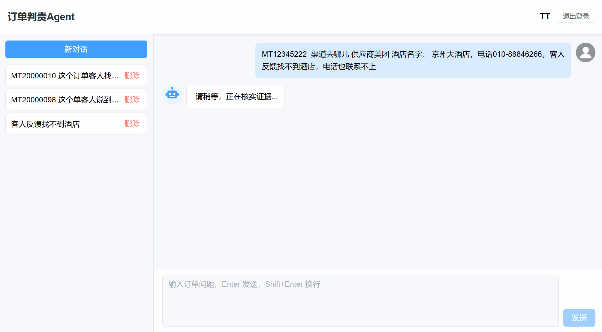
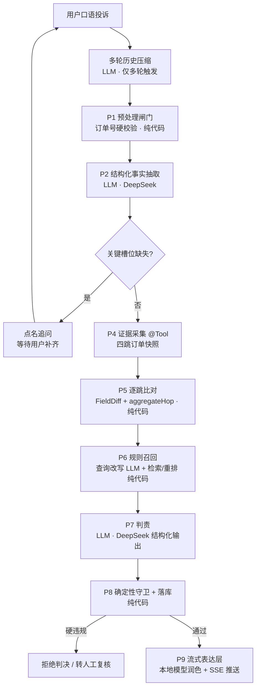

# Order Liability Agent · 酒店问题订单判责 AI Agent


用户用口语投诉酒店订单问题（"页面写大床，到店给了双床"），Agent 沿 **供应商 → 我司 → 渠道 → 客人** 四跳证据链定位第一个出错环节，RAG 召回判责规则，LLM 出具结构化判决，**纯代码守卫防幻觉**，结论与依据落库、可回放。

基于 Spring AI 的模块化 RAG 与扩展点（`ChatMemoryRepository` / `Advisor` / `@Tool`）构建，覆盖 AI 应用工程的完整链路：结构化输出、召回评测、模型分级、token 计量、SSE 流式输出。

**设计原则：LLM 只负责理解与表达，事实比对、检索重排、守卫校验全部是确定性代码。**

## 流程演示



## 核心亮点

- **模块化 RAG 全链**：自定义历史压缩变换器与优先级重排器，检索/判责双表示分离，`content_hash` 幂等增量灌库
- **召回评测体系**：217 条人工标注样本（含 67 条口语化噪声），查询改写使 Hit@5 从 0.718 提升至 0.981、MRR 从 0.885 提升至 0.965，评测数据否决本地小模型改写方案
- **自研 JDBC 对话记忆**：实现 Spring AI `ChatMemoryRepository`，窗口截断、完结打标、活跃视图隔离，多轮历史压缩支撑缺槽补齐
- **结构化输出 + 确定性守卫**：候选集成员 / 分支一致性 / 置信度三重校验，硬违规拦截、软风险转人工
- **"先判后说"两段式流式**：同步判责保证事实可靠，本地轻量模型 SSE 润色表达，带表达守卫与超时降级
- **模型分级 + 全链路 token 计量**：重任务云端、轻任务本地，按步骤落运行轨迹表，会话级汇总

## 系统架构



同步主流程的 LLM 调用点只有四处：历史压缩（仅多轮）、P2 抽取、P6 查询改写、P7 判责；证据比对、向量检索、重排、守卫校验均为确定性代码。全链路每一步的输入输出、模型与 token 用量落 `t_run_trace`，判决可按轮回放。

## 判责领域模型：四跳证据链

```text
供应商源数据 → 我司映射/传输 → 渠道页面展示 → 客人实际体验
```

判责不靠 LLM 自由心证，而是先由代码逐跳 diff 定位 **第一个出错环节（firstBadHop）**，再交给规则分支裁决：

| 责任结论 | 含义 |
|---|---|
| `OURS` | 我司映射/传输偏离源数据 → 我司主责 |
| `CHANNEL` | 渠道展示偏离下发数据 → 渠道主责 |
| `SUPPLIER` | 链路一致但与客人实际不符 → 酒店执行侧主责 |
| `NONE` | 四跳全一致，投诉不成立或转人工 |
| `EVIDENCE_GAP` | 任一跳证据缺失 → 转人工 |

支持最多 2 个同维度争议字段并行比对：每字段各自逐跳 diff，整体 firstBadHop 按优先级聚合取最靠前出错环节，守卫按聚合结果校验规则分支。

## 关键设计

### 1. 模块化 RAG 全链

基于 Spring AI 模块化 RAG 的四类接口组装完整检索链，核心组件自研、其余按业务深度定制：

| 阶段 | 组件 | 实现方式 |
|---|---|---|
| 查询变换 | `QueryTransformer` | 自研 `HistoryCompressionTransformer`（多轮历史压缩，空历史短路不调 LLM）+ `RewriteQueryTransformer` 定制中文改写模板（保留核心事实、去情绪噪声、补规范术语） |
| 检索 | `DocumentRetriever` | `VectorStoreDocumentRetriever` + 维度 metadata 过滤表达式 |
| 重排 | `DocumentPostProcessor` | 自研 `PriorityRerankPostProcessor`：综合分 = 0.7 × 相似度 + 0.3 × priority/1000，按 rule_id 去重截断 |
| 增强 | `QueryAugmenter` | `ContextualQueryAugmenter` 定制空上下文话术，`allowEmptyContext=false` 禁止无召回时 LLM 自由发挥 |

**检索/判责双表示分离**：向量库只嵌入规则名 + 58 组口语别名（检索表示，弥合投诉口语与规则书面语的词汇鸿沟）；判责时按召回的 rule_id 回查 MySQL 取规则全文与分支裁决（判责表示），单独拼接判责 prompt。收益：规则全文变更不触发重嵌入，检索文本精简稳定，判责拿到完整裁决依据。

**幂等增量灌库**：`UUID(rule_id)` 作为文档 id + `content_hash` 比对，规则文本或别名变更时启动自动增量重嵌，重复启动不产生脏数据。

**生产检索参数**：维度过滤 + topK=5 + 相似度阈值 0.60，重排截断 top3。向量库为 PgVector（HNSW 索引、余弦距离、1024 维，`qwen3-embedding:0.6b` 本地嵌入）。

### 2. 结构化输出与确定性守卫

- `responseEntity()` + `validateSchema`：校验失败携带错误反馈重试（默认 3 次）；责任方枚举直接生成 JSON Schema enum 约束，反序列化兼容枚举名与中文。
- **硬违规**（抛异常终止判决）：空判决 / 缺 ruleId / 缺责任方 / ruleId 不在召回候选集（幻觉引用）/ 分支不一致且无理由。
- **软风险**（`needsReview=true` 转人工）：分支不一致但附理由、置信度 < 0.6、聚合 hop 为 NONE / EVIDENCE_GAP。
- 用户结论确定性兜底：LLM 漏输出时按枚举中文名 + 规则名生成，不依赖模型二次发挥。
- 判决、证据 diff、规则引用、token 用量全部落库，每一轮可复核、可回放。

### 3. 自研对话记忆存储

- 实现 Spring AI `ChatMemoryRepository` 接口的 JDBC 持久化：追加式写入（DB 序号）、10 条消息窗口截断。
- **记忆读写收归编排层手动管理**：弃用 `MessageChatMemoryAdvisor` 自动记忆——它存的是模型调用级的 prompt 模板 + 结构化 JSON，会严重污染历史压缩；改为按业务轮次写入"压缩后自包含输入 + 面向用户结论"的干净消息对。
- **完结隔离**：判责完结轮次 USER/ASSISTANT 成对打 `completed` 标记，历史压缩只读活跃视图；全量数据保留可回放，已完结订单不串扰后续对话。
- **多轮缺槽补齐**：历史压缩前置到 P1 之前，把历史 + 当前输入合成自包含查询，追问补齐的订单号、争议字段能正确进入抽取。

### 4. 模型分级与 token 计量

- 重任务（事实抽取 / 判责）挂 DeepSeek 云端模型保质量；轻任务（流式表达）挂本地 Ollama `qwen3:4b-instruct`，零云端成本。
- 查询改写当前使用 DeepSeek：本地 `qwen2.5:3b` 候选因改写偏离原义被评测否决，模型切换点已预留（见[召回评测](#召回评测)）。
- 自定义 `TokenUsageAdvisor`（`CallAdvisor` + `StreamAdvisor`）统一计量，按步骤落 `t_run_trace`（model / prompt / completion / total）；会话级汇总以 trace 表为唯一事实源，新增 LLM 步骤自动纳入统计。

### 5. SSE 流式输出："先判后说"

- P1-P8 保持同步：结构化判决与守卫校验需要完整结果，可靠性阶段不流式。
- 守卫通过后进入 P9 表达层：本地轻量模型把**已验证的结论**润色成客服话术，`ChatClient.stream()` + `Flux<ServerSentEvent>` 推送。守卫管事实，流式管表达。
- 事件协议：`delta` 增量文本 / `done` 最终全文（权威值，前端整体替换）。
- 表达守卫：聚合后校验规则编号未丢失，丢失则整体替换回原结论；超时 60s 或 Ollama 不可用时降级直发原结论。
- 非判责路径（追问 / 无规则 / 失败）不调 LLM，固定话术切片流式，行为一致。

## 召回评测

检索质量决定判责上限：正确规则没被召回，判责 LLM 再强也只能在错误候选里挑。topK、阈值、重排权重、是否改写，全部用数据调，不靠感觉。

- **数据集**：103 条人工标注样本 = 48 条规范问法 + 55 条口语化噪声（情绪夸张 / 方言词 / 间接描述 / 同维度多期望 / 易混对），覆盖 6 个规则维度。
- **指标**：Hit@K、MRR、Recall@K，附分维度命中率与 failures 明细（期望谁、实际召回谁、分数多少）。
- **实测结果**（topK=5、阈值 0.65，DeepSeek 改写）：

| 配置 | Hit@5 | MRR | failures |
|---|---|---|---|
| 无改写 | 0.718 | 0.709 | 29 |
| 历史压缩 + 查询改写 | **0.981** | **0.956** | **2** |

- **评测驱动选型**：本地 `qwen2.5:3b` 改写偏离原义，被评测数据否决——查询侧暂用 DeepSeek，候选升级模型验证达标后再切回本地降本。

运行方式（需先启动应用完成灌库，详见 [EVALUATION.md](EVALUATION.md)）：

```bash
mvn test "-Dtest=RetrievalEvaluationTest#baselineGridSearch"        # 纯检索参数网格，不调 LLM
mvn test "-Dtest=RetrievalEvaluationTest#productionPathWithRerank"  # 生产路径：检索 + 重排
mvn test "-Dtest=RetrievalEvaluationTest#queryTransformComparison"  # 改写前后对比
```

**边界说明**：评测中维度由样本给定，生产中来自由 P2 抽取，抽取错误会连带检索错误；检索指标优秀不等于端到端判责生产就绪，端到端评测（查询 → 期望责任方一致率）是下一步。

## 技术栈

| 类别 | 选型 |
|---|---|
| 语言 / 框架 | Java 21、Spring Boot 4.1.2、Spring AI 2.0.2 |
| AI 能力 | 模块化 RAG、ChatClient 结构化输出、自定义 Advisor、`@Tool` 工具调用、SSE 流式 |
| 业务存储 | MySQL + MyBatis-Plus 3.5.18（订单 / 规则 / 会话 / 记忆 / 轨迹） |
| 向量存储 | PostgreSQL + pgvector（HNSW、余弦距离、1024 维） |
| 本地模型 | Ollama：`qwen3-embedding:0.6b`（嵌入）、`qwen3:4b-instruct`（流式表达） |
| 云端模型 | DeepSeek（事实抽取 / 查询改写 / 判责） |
| 测试 | JUnit 5，43 个纯单元测试（不依赖外部服务） |

## 快速开始

### 环境要求

- JDK 21、Maven 3.9+
- MySQL（业务库）
- PostgreSQL + pgvector 扩展（向量库，首次启动自动建表建索引）
- Ollama（本地嵌入与表达模型）
- DeepSeek API Key

### 1. 初始化 MySQL

```sql
CREATE DATABASE order_liability_agent DEFAULT CHARACTER SET utf8mb4;
```

依次执行 `src/main/resources/db/` 下脚本：`schema.sql`（全量建表）→ `rule_data_v2.sql`（69 条判责规则）→ `order_data.sql`（30 条演示订单）。

### 2. 准备 PostgreSQL

创建空数据库（如 `ai_agent`）即可，向量表 `rule` 与 HNSW 索引由应用首次启动自动初始化（`initializeSchema=true`）。

### 3. 启动 Ollama 并拉取模型

```bash
ollama pull qwen3-embedding:0.6b
ollama pull qwen3:4b-instruct
```

建议设置环境变量 `OLLAMA_NUM_PARALLEL=2`：默认单并发下嵌入与聊天请求会排队，表现为"卡住无输出"。

### 4. 配置密钥

项目根目录创建 `.env`（已被 gitignore，不会入库）：

```properties
DEEPSEEK_API_KEY=sk-your-key
```

### 5. 配置数据源

创建 `src/main/resources/application-local.yml`（已被 gitignore）：

```yaml
spring:
  datasource:
    mysql:
      url: jdbc:mysql://127.0.0.1:3306/order_liability_agent?useUnicode=true&characterEncoding=utf-8&useSSL=false&serverTimezone=Asia/Shanghai
      username: your-user
      password: your-password
    pgsql:
      url: jdbc:postgresql://127.0.0.1:5432/ai_agent
      username: your-user
      password: your-password
```

### 6. 启动并验证

```bash
mvn spring-boot:run   # 需 JDK 21 环境
```

首次启动自动把规则灌入向量库（幂等增量）。服务端口 `8787`，上下文路径 `/api`。

```bash
curl -G "http://localhost:8787/api/liability/judge" \
  --data-urlencode "userPrompt=订单MT12345222，页面写的大床房，到店给了双床，太气人了" \
  --data-urlencode "chatId=demo-001"
```

返回 `stage=P8_JUDGED` 的 JSON：`orderNo` / `diffList`（逐跳证据比对）/ `judgment`（结构化判决）/ `needsReview` / `guardIssues`。

## API 概览

统一响应体 `{code, data, message}`；登录态基于 HttpSession（Cookie），聊天接口均校验登录与归属。

| 模块 | 方法 | 路径 | 说明 |
|---|---|---|---|
| 用户 | POST | `/api/user/register` | 注册 |
| 用户 | POST | `/api/user/login` | 登录 |
| 用户 | POST | `/api/user/logout` | 注销 |
| 用户 | GET | `/api/user/get/login` | 查询登录态 |
| 判责 | GET/POST | `/api/liability/judge` | 单轮判责入口（`userPrompt` + `chatId`） |
| 聊天 | POST | `/api/chat/create` | 创建对话，返回 chatId |
| 聊天 | GET | `/api/chat/list` | 当前用户对话列表 |
| 聊天 | GET | `/api/chat/history` | 对话展示历史 |
| 聊天 | POST | `/api/chat/send` | 同步发送（降级通道） |
| 聊天 | POST | `/api/chat/send/stream` | SSE 流式发送，事件 `delta` / `done` |
| 聊天 | POST | `/api/chat/delete` | 删除对话（轨迹保留供审计） |

## 数据模型

| 表 | 职责 |
|---|---|
| `t_user` | 用户账号 |
| `t_order` | 订单四跳证据：order_no 唯一 + 四个 JSON 快照列，30 条演示订单覆盖 5 种责任结论 |
| `t_rule` | 判责规则 69 条：`content_md` 判责全文 + `branches_json` 分支裁决 |
| `t_session` | 会话轮次：chat_id 多轮组织，content / result / reason / total_tokens |
| `t_chat_memory` | 对话记忆：completed 完结打标，全量保留、活跃视图过滤 |
| `t_run_trace` | 运行轨迹：每步输入输出 / 模型 / token 实值，回放与审计的唯一事实源 |

`db/` 脚本说明：`schema.sql` 全量建表；`rule_data_v2.sql` 规则数据（REPLACE INTO，可重复执行）；`order_data.sql` 演示订单；`migration_*.sql` 供存量库增量迁移。

## 项目结构

```text
src/main/java/com/twithu/orderliabilityagent/
├── core/                     # P1-P8 编排、LLM 封装、预处理闸门
│   ├── evidence/             # @Tool 证据采集、逐跳比对器、Repository 抽象
│   └── guard/                # 确定性判决守卫
├── rag/                      # 模块化 RAG：灌库、Advisor 组装、评测
│   ├── preretrieval/         # 自研历史压缩变换器
│   ├── postretrieval/        # 自研优先级加权重排器
│   ├── transform/            # 规则元数据富化（口语别名）
│   └── eval/                 # 召回评测器与指标报告
├── custom/                   # 自研 JDBC ChatMemoryRepository
├── advisor/                  # TokenUsageAdvisor 统一计量
├── controller/               # 用户 / 聊天 / 判责接口
├── service/                  # 会话、聊天、流式表达与表达守卫
├── config/                   # 双数据源、PgVector、CORS
├── entity/ mapper/ model/    # MyBatis-Plus 实体与 DTO/VO
└── common/                   # 统一响应、异常处理

src/main/resources/
├── db/                       # 建表、规则数据、演示订单、迁移脚本
├── docs/rule.json            # 规则库源数据（69 条，6 维度）
├── prompt/                   # 抽取 / 判责 prompt 模板
└── rag/issue-aliases.json    # 58 组口语别名配置
```

## 测试

43 个纯单元测试，不依赖数据库与模型服务：

| 测试类 | 数量 | 覆盖 |
|---|---|---|
| `JudgmentGuardTest` | 8 | 守卫硬违规 / 软风险分级 |
| `EvidenceComparatorTest` | 9 | 逐跳比对与 hop 聚合 |
| `UserPromptPreprocessTest` | 4 | 订单号闸门 |
| `RuleMetadataEnricherTest` | 4 | 口语别名富化 |
| `PriorityRerankPostProcessorTest` | 5 | 加权重排与去重截断 |
| `LiabilityOrchestratorAlignTest` | 3 | 争议字段对齐防越界 |
| `LiabilityOrchestratorResultTest` | 3 | 用户结论兜底 |
| `ChatServiceImplTest` | 7 | 标题截取 / 流式切片 / 表达守卫 |

```bash
mvn test "-Dtest=JudgmentGuardTest,EvidenceComparatorTest,UserPromptPreprocessTest,RuleMetadataEnricherTest,PriorityRerankPostProcessorTest,LiabilityOrchestratorAlignTest,LiabilityOrchestratorResultTest,ChatServiceImplTest" -DfailIfNoTests=false
```

集成测试与召回评测需要 MySQL / PostgreSQL / Ollama / DeepSeek 就绪，运行方式见 [EVALUATION.md](EVALUATION.md)。

## 已知限制与路线

- 跨维度多字段投诉当前只取主要字段；计划按字段维度分别召回再合并重排。
- 记忆完结闭环基于"单活跃问题"假设；交叉提问的精确闭环需按订单号打标。
- 订单证据为演示数据（30 条），`OrderEvidenceRepository` 抽象已预留接入真实订单系统。
- 召回评测的维度由样本给定；端到端判责评测（查询 → 期望责任方一致率）是下一步。
- 查询侧本地模型候选（`qwen3:4b-instruct`）待评测验证，达标后切回本地降本。

## 文档

- [EVALUATION.md](EVALUATION.md)：召回评测指南（指标算例 / 运行方式 / 调参逻辑）
- `src/main/resources/prompt/`：事实抽取与判责 prompt 模板
- `src/main/resources/docs/rule.json`：判责规则库（含分支裁决）
